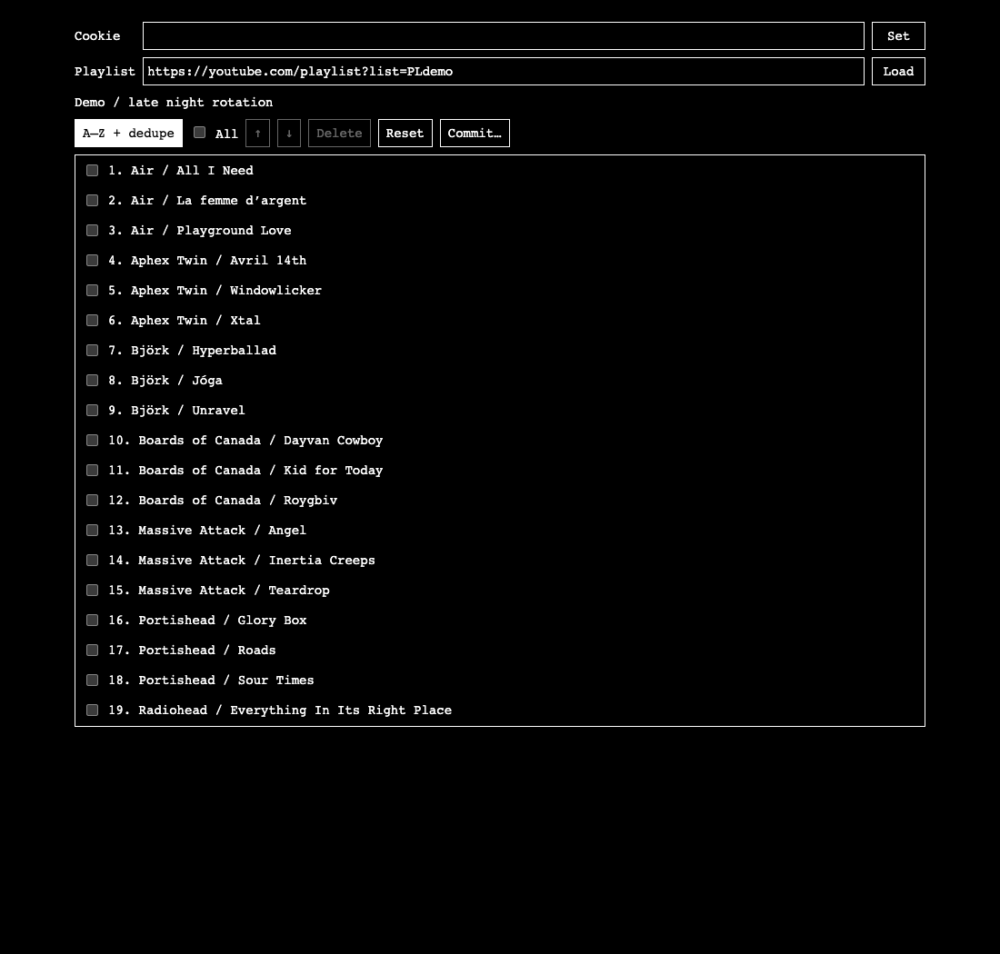

# ytplman

Sort, deduplicate and arrange a YouTube playlist.



## Run

Requires Node.js 24+.

```sh
npm ci
npm start
```

Open [localhost:3000](http://localhost:3000).

With Docker: `docker compose up --build -d`.

## Use

1. Paste your YouTube cookie and press **Set**. Paste an editable playlist link and press **Load**.
2. **A–Z + dedupe** sorts by channel, then title, keeping the first exact channel/title match.
3. Select songs to drag, move with **↑ / ↓**, or **Delete**. Shift-click selects a range. **Reset** discards edits.
4. **Commit…** previews changes. **Commit to YouTube** applies them and shows progress.

To get the cookie: sign in to YouTube → developer tools → Network → reload → select a YouTube request → copy **Request Headers → Cookie**.

Refreshing loses the cookie and edits. After a failed commit, load the playlist again. Keep cookies private and run on localhost.

[Contributing](CONTRIBUTING.md) · [Security](SECURITY.md) · [AGPL-3.0](LICENSE)
